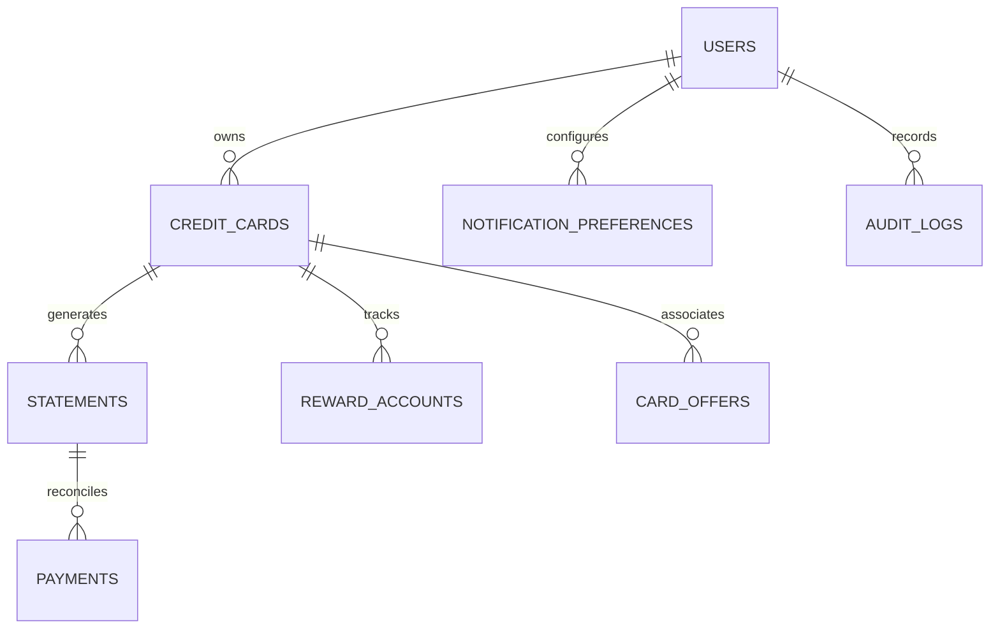

# CardWise Database Schema & Data Dictionary

## 1. Schema Overview

CardWise utilizes a normalized relational schema supporting multi-tenancy with strict user data isolation.

---

## 2. Table Specifications

### 2.1 `users`
Stores authenticated user accounts.
| Column | Type | Constraints | Description |
|---|---|---|---|
| `id` | VARCHAR(36) | PRIMARY KEY | UUIDv4 |
| `email` | VARCHAR(255) | UNIQUE, NOT NULL | Lowercase email index |
| `hashed_password` | VARCHAR(255) | NOT NULL | Bcrypt hash |
| `full_name` | VARCHAR(120) | NULL | Optional user display name |
| `currency` | VARCHAR(3) | DEFAULT 'INR' | ISO currency code |
| `is_active` | BOOLEAN | DEFAULT TRUE | Account state |
| `created_at` | TIMESTAMP | DEFAULT CURRENT_TIMESTAMP | UTC timestamp |
| `updated_at` | TIMESTAMP | DEFAULT CURRENT_TIMESTAMP | UTC timestamp |

### 2.2 `credit_cards`
Stores user-owned credit card metadata without full numbers or CVVs.
| Column | Type | Constraints | Description |
|---|---|---|---|
| `id` | VARCHAR(36) | PRIMARY KEY | UUIDv4 |
| `user_id` | VARCHAR(36) | FOREIGN KEY (users.id) | Enforces ownership |
| `issuer` | VARCHAR(80) | NOT NULL | e.g., "HDFC Bank", "ICICI Bank" |
| `variant` | VARCHAR(80) | NOT NULL | e.g., "Coral", "ACE", "Shoprite" |
| `nickname` | VARCHAR(80) | NULL | User custom name |
| `masked_number` | VARCHAR(20) | NOT NULL | e.g., "XXXX-XXXX-XXXX-7207" |
| `network` | VARCHAR(20) | NOT NULL | VISA, MASTERCARD, RUPAY, AMEX |
| `credit_limit` | NUMERIC(12, 2) | NULL | Sanctioned limit |
| `available_limit` | NUMERIC(12, 2) | NULL | Unspent limit |
| `billing_cycle_day` | INT | NOT NULL | Day of month (1-31) |
| `payment_due_days` | INT | DEFAULT 20 | Days after statement generation |
| `annual_fee` | NUMERIC(10, 2) | DEFAULT 0.00 | Annual maintenance charge |
| `joining_fee` | NUMERIC(10, 2) | DEFAULT 0.00 | One-time joining fee |
| `reward_type` | VARCHAR(40) | NOT NULL | CASHBACK, REWARD_POINTS, MILES |
| `base_earn_rate` | NUMERIC(5, 2) | DEFAULT 1.00 | Percentage or points multiplier |
| `point_redemption_inr` | NUMERIC(6, 4) | DEFAULT 0.2500 | Monetary conversion (₹ per point) |
| `is_verified` | BOOLEAN | DEFAULT FALSE | Whether details were verified |
| `is_archived` | BOOLEAN | DEFAULT FALSE | Soft deletion / archival |
| `created_at` | TIMESTAMP | DEFAULT CURRENT_TIMESTAMP | UTC timestamp |
| `updated_at` | TIMESTAMP | DEFAULT CURRENT_TIMESTAMP | UTC timestamp |

### 2.3 `statements`
Tracks monthly credit card statements.
| Column | Type | Constraints | Description |
|---|---|---|---|
| `id` | VARCHAR(36) | PRIMARY KEY | UUIDv4 |
| `card_id` | VARCHAR(36) | FOREIGN KEY (credit_cards.id) | Linked card |
| `user_id` | VARCHAR(36) | FOREIGN KEY (users.id) | Denormalized for security filter |
| `statement_date` | DATE | NOT NULL | Statement generation date |
| `payment_due_date` | DATE | NOT NULL | Payment deadline |
| `period_start` | DATE | NOT NULL | Billing period begin |
| `period_end` | DATE | NOT NULL | Billing period end |
| `total_balance` | NUMERIC(12, 2) | NOT NULL | Statement balance in INR |
| `minimum_due` | NUMERIC(12, 2) | NOT NULL | Minimum amount due |
| `is_paid` | BOOLEAN | DEFAULT FALSE | Marked paid status |
| `source` | VARCHAR(40) | DEFAULT 'MANUAL' | MANUAL or EXTRACTED |
| `document_ref` | VARCHAR(255) | NULL | Hash/Identifier of source file |
| `created_at` | TIMESTAMP | DEFAULT CURRENT_TIMESTAMP | UTC timestamp |

### 2.4 `payments`
Tracks planned and confirmed payments toward statements.
| Column | Type | Constraints | Description |
|---|---|---|---|
| `id` | VARCHAR(36) | PRIMARY KEY | UUIDv4 |
| `statement_id` | VARCHAR(36) | FOREIGN KEY (statements.id) | Associated statement |
| `user_id` | VARCHAR(36) | FOREIGN KEY (users.id) | Security barrier |
| `amount` | NUMERIC(12, 2) | NOT NULL | Payment amount |
| `planned_date` | DATE | NOT NULL | Scheduled execution date |
| `status` | VARCHAR(20) | NOT NULL | PLANNED, SUBMITTED, CONFIRMED, CANCELLED |
| `confirmed_at` | TIMESTAMP | NULL | Confirmation timestamp |
| `notes` | VARCHAR(255) | NULL | Optional user remarks |
| `created_at` | TIMESTAMP | DEFAULT CURRENT_TIMESTAMP | Record created |

### 2.5 `card_offers` & `reward_rules`
Stores benefit programs and offer rules for the Smart Card Matcher.
| Column | Type | Constraints | Description |
|---|---|---|---|
| `id` | VARCHAR(36) | PRIMARY KEY | UUIDv4 |
| `card_id` | VARCHAR(36) | NULL | Specific card or general bank offer |
| `issuer` | VARCHAR(80) | NOT NULL | Matching bank |
| `variant` | VARCHAR(80) | NULL | Matching variant |
| `category` | VARCHAR(40) | NOT NULL | SHOPPING, TRAVEL, FUEL, GROCERY, etc. |
| `merchant_keyword` | VARCHAR(100) | NULL | Specific merchant name filter |
| `benefit_type` | VARCHAR(30) | NOT NULL | CASHBACK_PERCENT, MULTIPLIER, FLAT_DISCOUNT |
| `benefit_value` | NUMERIC(6, 2) | NOT NULL | Percentage or point multiplier |
| `min_spend` | NUMERIC(10, 2) | DEFAULT 0.00 | Minimum transaction hurdle |
| `max_benefit_cap` | NUMERIC(10, 2) | NULL | Cap per transaction or cycle |
| `exclusion_details` | VARCHAR(255) | NULL | e.g., "Excludes wallet loads and rent" |
| `valid_from` | DATE | NOT NULL | Offer start date |
| `valid_to` | DATE | NOT NULL | Offer expiration date |
| `confidence` | VARCHAR(20) | DEFAULT 'VERIFIED' | VERIFIED, ESTIMATED, COMMUNITY |
